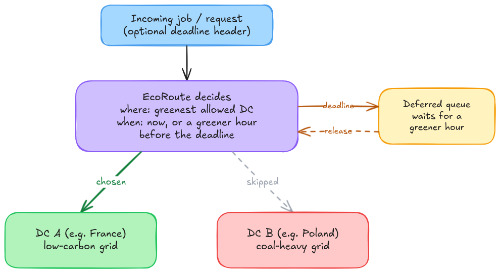
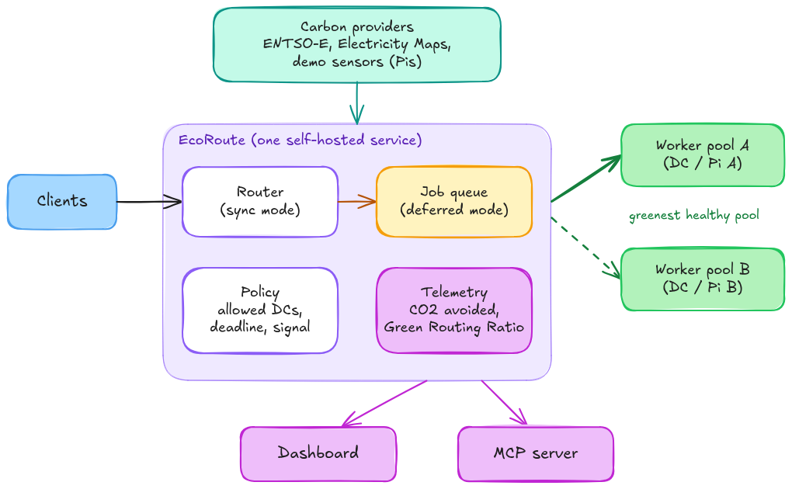

# EcoRoute: Carbon-Aware Workload Router for Hosting Providers

**Follow-the-Sun Routing**:
EcoRoute routes deferrable, compute-heavy jobs
(AI inference, video transcoding, image processing, CI/CD, backups, ETL)
to the data center, and the hour, where they cause the least CO₂.

It is built for hosting providers that run more than one data center:
the provider deploys EcoRoute once, and its customers' background jobs follow renewable surplus across its own sites.

1. **Space-shifting:** Sends each job to the allowed data center with the lowest carbon signal right now.
2. **Time-shifting:** Requests carrying a deadline (`X-EcoRoute-Deadline: 6h`) are accepted with `202 Accepted`,
   queued, and run in the greenest window before that deadline.
   On grids like Germany's, the gap between a sunny noon and a windless evening is larger than the gap between many neighbouring countries.
3. **Pluggable carbon signal:** Average intensity (what most dashboards show) and a marginal / surplus signal
   (is renewable power being curtailed or priced negative right now?) are separate providers. The README is explicit about which one is used for what.
4. **Sovereign by configuration:** Target data centers can be restricted per tenant or per request (e.g. EU-only, same-country-only).
5. **Self-hostable, no vendor API required:** Works with free ENTSO-E data out of the box; Electricity Maps / WattTime are optional providers.
6. **Honest telemetry:** Reports avoided emissions together with the method used and its assumptions, and the _Green Routing Ratio_.
7. **Agent-ready:** An MCP server lets agents ask "when and where should I run this 2-hour job?", not just read stats.
8. **Tactile Hardware Demo:** Raspberry Pis with solar panels show the routing decision live.

### When EcoRoute helps, and when it doesn't

EcoRoute only saves emissions when:

- the job is deferrable or location-independent (minutes to hours of slack, stateless or with small inputs),
- the data centers sit on **different grids** or the job can wait for a **different hour**,
- the capacity freed in the dirty location is actually powered down or reused, not left idling.

It does **not** help with latency-critical user traffic, or with jobs whose input data is much larger than their compute (moving 50 GB to save 2 kWh is a loss).
Research on 123 cloud regions ([Sukprasert et al., EuroSys 2024](https://arxiv.org/abs/2306.06502)) found that simple policies capture most of the achievable savings.
So EcoRoute's value is not a clever algorithm; it is making the simple policy easy to deploy, constrain and verify.

## Why hosting providers

Multi-site European hosters already span grids with very different carbon intensities (France, Finland, Germany, Poland, the UK, Spain).
They control both the infrastructure and the pricing, which makes them the party that can turn green hours into a product:

- **Green-hour pricing:** Like spot instances, but priced by renewable surplus. Day-ahead electricity prices in Europe drop during solar and wind peaks, and turn negative several hundred hours per year in Germany.
  A hoster on a dynamic or spot-indexed supply contract can pass part of that saving to customers who mark jobs as deferrable.
- **Reporting:** CSRD pushes providers' business customers to report Scope 3 emissions. Per-job, per-tenant CO₂ data with a stated method is something a hoster can sell or include.

## Architecture

**Hackathon scope:** one self-hosted service (TypeScript / Node.js, Fastify) that acts as reverse proxy and job dispatcher.

- **Sync mode:** a request without a deadline is forwarded to the greenest allowed worker pool immediately.
- **Deferred mode:** a request with a deadline is queued; EcoRoute picks the start time and place from the forecast, then delivers the result via callback URL or a status endpoint.
- **Failover:** if the greenest pool is unhealthy or full, EcoRoute falls back to the next one. Carbon never overrides availability.

Complements existing load balancers (Nginx, HAProxy, Traefik); it sits behind TLS termination and DDoS protection.

**After the hackathon** (not built during the weekend):

- Edge deployment (Cloudflare Workers / Fastly Compute) using the same routing core
- Client SDKs (`npm`/`pip`) for proxy-less use
- Kubernetes integration (Karmada / KEDA) for multi-cluster placement
- Integrations into hosting control panels and job queues

## Deliverables

- **Reverse proxy + deferred job queue** with carbon-aware placement and EU / per-tenant constraints
- **Carbon providers:** ENTSO-E (average intensity computed from generation mix, plus a surplus signal from day-ahead prices), a demo-sensor provider for the Pis, and an optional Electricity Maps adapter
- **Dashboard:** live routing on a map, per-site carbon signal, CO₂ avoided vs. a carbon-agnostic baseline, _Green Routing Ratio_
- **Backtest mode:** replay a year of hourly data for a given set of data centers and job profile, and report what EcoRoute would have saved. This answers "is it worth deploying?" with numbers.
- Add-On: **MCP server** with tools such as `find_green_window(duration, deadline, allowed_regions)` and `get_job_footprint(job_id)`
- Add-On: **OpenAI-compatible endpoint** (`/v1/chat/completions`) that routes batch inference between self-hosted model servers

## Inputs

- **Carbon data:**
  - ENTSO-E Transparency Platform (free, API token on request): generation mix per bidding zone and day-ahead prices
  - Electricity Maps historical hourly CSVs (free, ODbL) for backtests and demo replay
  - Optional paid APIs: Electricity Maps, WattTime (marginal signals)
- **Constraints:**
  config files, environment variables, or request headers (`X-EcoRoute-Zone: EU-only`, `X-EcoRoute-Deadline: 6h`, `ALLOWED_REGIONS=[...]`)

## Physical Hardware Live Demo

3–4 Raspberry Pis represent data centers on different grids (Nordics, Central Europe, Southern Europe).
Each Pi has a mini solar panel and sits on a 3D-printed diorama.

Shining a flashlight on a panel simulates a solar surplus and lowers that site's carbon signal.
Workloads are generated automatically in realistic burst patterns; EcoRoute routes them to the greenest Pi, which executes them
(image transcoding, a small local LLM, or a simulated job for stage reliability).
Deferred jobs pile up in a visible queue and are released when a panel lights up.

The dashboard and each Pi's CPU load (shown on its status LEDs) make the routing visible.

## Related Work

Carbon-aware placement is an active research area and there are several early open-source projects. EcoRoute differs in target user and deployment model:

| Project                                                                           | What it does                                              | Difference to EcoRoute                                            |
| --------------------------------------------------------------------------------- | --------------------------------------------------------- | ----------------------------------------------------------------- |
| [GSF Carbon Aware SDK][carbon-aware-sdk]                                          | Library / Web API that returns the best time and location | Gives a recommendation; does not route or queue                   |
| [Cloudflare Green Compute][cf-green-compute]                                      | Runs Cron Triggers only in renewable-powered PoPs         | Cloudflare-only, cron only, based on annual renewable procurement |
| [Carbon-aware KEDA operator][keda-carbon], [Karmada-based schedulers][k8s-survey] | Kubernetes scaling / placement by carbon                  | Requires Kubernetes; not request-level                            |
| [CASPER][casper] (research)                                                       | Weights Traefik across regions by carbon and SLO          | Research prototype, not packaged                                  |
| [CarbonRoute][carbonroute], [CarbonServe][carbonserve] (GitHub)                   | Route LLM requests between cloud regions                  | LLM-only, hyperscaler-oriented, early stage                       |
| [CodeCarbon][codecarbon], [Kepler][kepler]                                        | Measure emissions                                         | Measurement only, no shifting                                     |

EcoRoute's niche: a self-hostable, provider-side router for multi-site hosters, with time- and space-shifting, sovereignty constraints, free EU data sources and a stated accounting method.

[carbon-aware-sdk]: https://github.com/Green-Software-Foundation/carbon-aware-sdk
[cf-green-compute]: https://blog.cloudflare.com/announcing-green-compute/
[keda-carbon]: https://github.com/Azure/carbon-aware-keda-operator
[k8s-survey]: https://arxiv.org/abs/2508.05949
[casper]: https://arxiv.org/abs/2403.14792
[carbonroute]: https://github.com/dheerajeshwar32/carbonroute-api
[carbonserve]: https://github.com/RavaniRoshan/carbonserve
[codecarbon]: https://github.com/mlco2/codecarbon
[kepler]: https://github.com/sustainable-computing-io/kepler

## About the Project Leads

EcoRoute is led by **Alexander Melde** and **Milan Ferus-Comelo**, combining enterprise software development with award-winning IoT prototyping.

Alexander (M.Sc. in Computer Science) contributes deep expertise in full-stack development, TypeScript, and AI systems, paired with energy-sector domain knowledge building grid-sensor solutions.

Milan is an edge-hardware and IoT developer who won three awards at CloudFest Hackathon 2026. He previously worked at a cloud engineering consultancy, where he saw how enterprises run on the cloud, and he now builds the physical side of it. His work on the Sustainable Development Goals has been recognized by the KI Bundesverband, the United Nations and the German Federal Ministry of Research, Technology and Space.

## Summaries for the project submission:

**Pitch / Description:**
EcoRoute is a carbon-aware job router that sends heavy compute wherever, and whenever, the sun is shining or the wind is blowing.
Hosting providers deploy it once across their data centers; their customers' deferrable jobs (AI inference, video transcoding, image processing, CI/CD, backups) then run at the site and hour with the lowest grid emissions.
It's a self-hosted reverse proxy with a job queue, so applications only change an endpoint and optionally add a deadline header.
It runs on free European grid data, respects EU-only and per-tenant constraints, and reports savings with a transparent method.

**Goal / MVP by the End of the Hackathon:**
A working reverse proxy and deferred job queue that places jobs by live carbon data, with a dashboard showing CO₂ avoided against a carbon-agnostic baseline.
A backtest mode replays last year's hourly grid data to show what a real set of data centers would have saved.
To make it tangible, we're bringing Raspberry Pis with mini solar panels: shine a flashlight on one and watch EcoRoute move the workload there and release queued jobs.
An MCP server lets AI agents ask EcoRoute when and where to run their own jobs.

**Long-Term Viability Post-Hackathon:**
EU sustainability reporting (CSRD) is pushing hosting customers to account for their emissions, and hosters with several sites are positioned to offer greener compute without a hyperscaler.
EcoRoute gives them an open-source building block for that: carbon-aware placement, per-tenant reporting, and the basis for "green-hour" pricing that passes cheap renewable surplus on to customers.
Next steps are edge deployment, Kubernetes integration and connectors for common job queues and hosting control panels.
